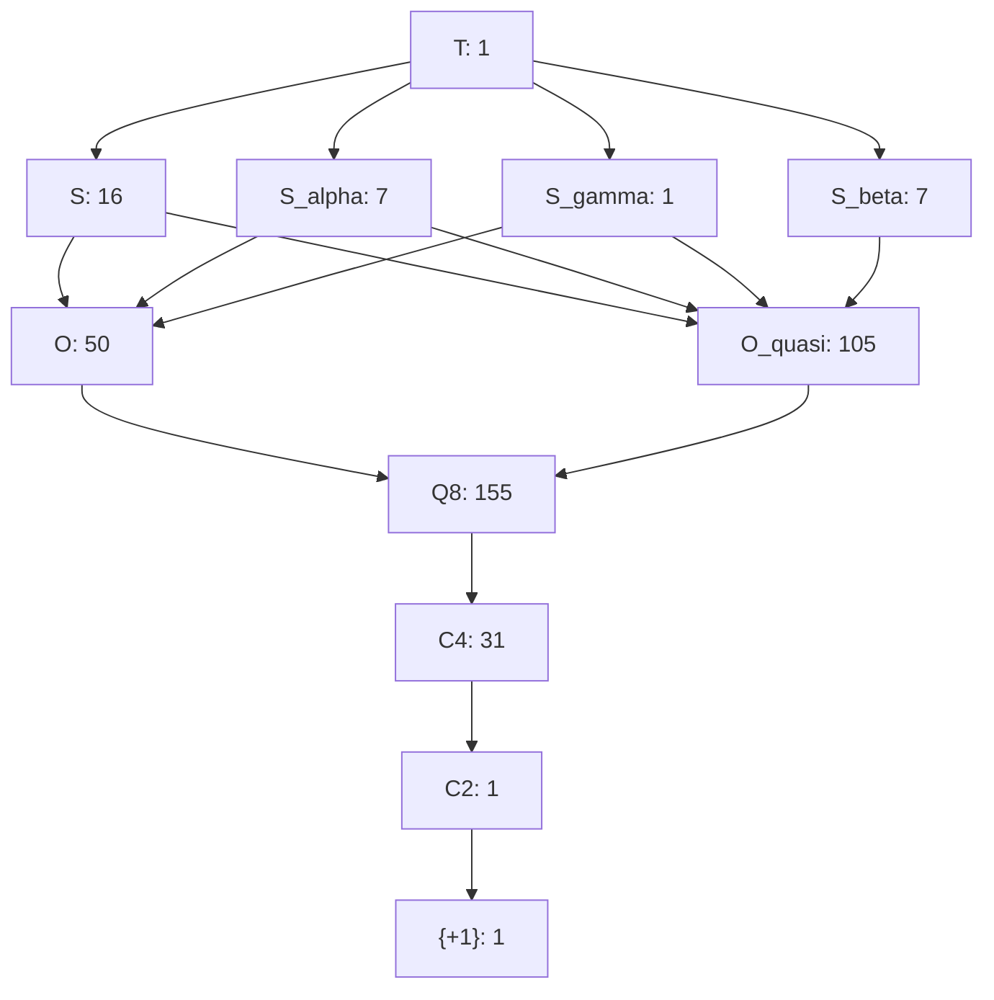

# Verification of Cawagas et al., arXiv:0907.2047v3

Raoul E. Cawagas, Alexander S. Carrascal, Lincoln A. Bautista, John P. Sta. Maria, Jackie D. Urrutia and Bernadeth Nobles, **The Basic Subalgebra Structure of the Cayley-Dickson Algebra of Dimension 32 (Trigintaduonions)**, version 3, 1 September 2009, 9 PDF pages. Printed and PDF page numbers agree.

Source: `0907.2047v3.pdf`.
SHA-256: `202833bbbf36b0c8bb6ca0c448c98df3f21e2f072a82e3b30c0b029f19cb8ce1`.
The complete extracted text was reviewed. Pages 4–5 and 7–8, all embedded table images and Figure 1 were also inspected visually. The PDF is unchanged and not duplicated in git. The review concerns this supplied version, without an external literature/version-history audit.

## Recorded outcome

On 22 October 2026, the paper-specific runner completed **35 tests: 32 passed, 3 skipped**, with no failures or errors. All CPU assertions use exact integer/rational arithmetic, including NumPy integer tables. The three direct GPU checks skipped because CuPy is unavailable; a loaded shared library alone does not demonstrate CUDA execution.

The paper's principal finite claims are reproduced: **373 proper nontrivial subloops, nine isomorphism classes, four sedenion-type classes, two octonion-type classes, the three maximal-subloop composition types, normality and modularity**. Every class membership is backed by an explicit signed product-preserving map, not merely a matching invariant. Exact zero-divisor witnesses are saved for all 105 quasi-octonion and all 31 sedenion-type coordinate algebras.

The main presentation discrepancy is that **the images numbered Tables 3 and 4 are exchanged relative to their captions**. Their actual multiplication entries agree with CayleyKernel when the image headers are used. A passing discrepancy regression means this exchange was reproduced, not that the captions were verified. [FINDINGS.md](FINDINGS.md) explains it and the scope cautions.

The suite also constructs the **complete 375-node subloop lattice**, with **2,078 cover edges**, and checks **2,304,000 instances** of the modular law. This extends the paper's block diagram, which explicitly leaves the complete lattice for future work.

## What the paper means

Start with the 32 coordinate basis vectors of the trigintaduonions. Include their negatives to get a finite set of 64 elements. Multiplying two of these always gives another signed basis vector, forming a loop: division equations have unique answers, but associativity can fail.

A subloop is a smaller subset closed under these operations. Its real linear span gives a coordinate, or “basic,” subalgebra. Because both signs span the same real direction, a loop of order 32 gives an algebra of dimension 16, not 32. The paper sorts these finite objects and records which fit inside which.

This finite basis structure is different from the collection of **all** real subalgebras, where generators can be arbitrary real combinations. Likewise, a multiplication identity on signed basis vectors need not survive on their sums. The tests explicitly exercise both distinctions.

## Files and reproduction

- [loops.py](../../../tests/papers/arxiv_0907_2047/loops.py): signed-loop arithmetic, independent doubling, subspace enumeration, invariants, explicit isomorphism search and validation, exact polynomial checks, zero-divisor search and lattice construction.
- [tables.py](../../../tests/papers/arxiv_0907_2047/tables.py): independent literal transcriptions of Tables 2–5, four rows of Table 1, and image-header/caption conventions.
- [test_sections.py](../../../tests/papers/arxiv_0907_2047/test_sections.py): complete paper-ordered tests and optional GPU replays.
- [run.py](../../../tests/papers/arxiv_0907_2047/run.py): standalone runner, provenance and certificate export.
- [results/results.json](results/results.json): every pass/skip, observations, counterexamples, source/PDF hashes, runtime information and elapsed suite time.
- [results/test-output.txt](results/test-output.txt): complete test log.
- [results/subloops.json](results/subloops.json): all 375 nodes, their supports/classes, representative isomorphism maps and all 2,078 immediate inclusions.

From the repository root:

```bash
python3 -m tests.papers.arxiv_0907_2047.run
```

Regenerate all three saved result files:

```bash
python3 -m tests.papers.arxiv_0907_2047.run \
  --paper /path/to/papers/0907.2047v3.pdf \
  --output /tmp/cayley-paper-0907.2047/results
```

Python and NumPy suffice for CPU checks. No GAP, FINITAS, symbolic-math package or pytest is required. With pytest installed:

```bash
python3 -m pytest -v tests/papers/arxiv_0907_2047/test_sections.py
```

Both test classes carry the repository's `cpu` marker to bypass its general GPU prerequisite fixture. GPU tests check their own CuPy/device/library prerequisites; subsequent device errors or mismatches fail rather than triggering a CPU substitute. The standalone runner executes CPU tests in paper order, then GPU replays.

Git HEAD and hashes of all paper Python files plus `CayleyKernel/__init__.py` are recorded. Existing uncommitted work means HEAD alone is not the tested source identity. The certificate dataset repeats the source hashes. Its deterministic node numbers are **not** the paper's FINITAS numbers.

## Conventions and completeness

The paper uses zero-based basis indices, just like `twist()`. There is no basis permutation. `basis()` instead accepts signed, one-based labels: paper `+e0` is API label +1, paper `-e0` is label -1, and paper `-e31` is label -32. In a transcribed table the token `-0` means **negative identity**; converting it directly to an integer would lose the sign. `decode()` preserves it.

`TABLE` contains all 4,096 signed products computed by `basis()`. `SIGNS` uses `twist()`. An independent four-branch recursive doubling oracle supplies separate expectations for every ordered basis pair and every sign combination. Since `basis()` internally calls `twist()`, agreement between those two public routines alone would not establish correctness.

A support is encoded as a 32-bit membership mask. Nontrivial signed subloops correspond exactly to F2-linear subspaces of the five-bit basis indices:

1. Every nonidentity element either is -1 or has square -1, so a nontrivial subloop contains -1.
2. Multiplying by -1 supplies both signs of every included basis vector.
3. Absolute basis indices multiply by XOR, so their support is a vector subspace.
4. Conversely, the full signed preimage of an XOR subspace is closed and inherits the loop operations.

`all_spaces()` starts with {0}, adjoins every possible new vector and deduplicates spans. It enumerates all 374 vector subspaces, including {0} and the full space. Adding the singleton loop {+1} gives **375 total subloops**. Removing that singleton and the ambient loop leaves the paper's 373 proper nontrivial subloops.

| Proper loop order | Algebra dimension | Count | Class counts |
| --- | --- | --- | --- |
| 32 | 16 | 31 | S:16, S_alpha:7, S_beta:7, S_gamma:1 |
| 16 | 8 | 155 | O:50, O_quasi:105 |
| 8 | 4 | 155 | Q8:155 |
| 4 | 2 | 31 | C4:31 |
| 2 | 1 | 1 | C2:1 |

The singleton is not separately counted as a basic algebra: its real span is already the real line generated by C2. The full T loop is separately included only when constructing the complete lattice.

## How isomorphism claims are certified

For each candidate, the code first computes two signed-loop invariants: its per-element associator-failure profile and its total Moufang failures. These distinguish all nine classes in the finite collection, including S and S_gamma, which have the same maximal-subloop composition.

Matching an invariant is only a filter. The code then searches invertible binary-coordinate maps and builds a signed map from the relevant printed representative to the candidate. Generator-word phases determine the signs. **Every product of every signed pair** is checked directly against public `basis()` before accepting a certificate. Distinct representative invariants prove that different classes are nonisomorphic; explicit certificates prove that each listed member belongs to its class.

For rank four the search space has 20,160 invertible binary maps. Certificates are exported as pairs of signed one-based labels, from representative to target. Their real linear extensions preserve algebra products by bilinearity. This proves existence of those signed basis isomorphisms; it does not classify all possible arbitrary real-linear algebra isomorphisms.

## Complete test inventory in paper order

Identifiers below are method names in `PaperVerification`, omitting the common `test_` prefix. Every coded CPU test is listed. Unless explicitly called a sample, the finite domain named is exhausted.

### 1. Introduction, pages 1–2

| Test | What is checked |
| --- | --- |
| `01_01_intro_embeddings_and_standard_sedenion_octonion_composition` | Standard coordinate embeddings in dimensions 1,2,4,8,16 agree with independent lower-dimensional doubling; the standard sedenion support contains exactly eight ordinary and seven quasi-octonion maximal subloops. Confirms the introductory account within the selected basis structure. |

Historical novelty, applications to physics and the cited software's internals are not tested. They are separate from the finite algebraic claims.

### 2. Methodology, definitions and notation, pages 2–3

| Test | What is checked |
| --- | --- |
| `02_01_notation_all_twists_signed_basis_and_independent_doubling` | All 1,024 unsigned basis pairs and all four sign combinations agree among `twist`, `basis` and independent doubling; explicit positive/negative identity token parsing. |
| `02_02_full_loop_latin_square_identity_inverse_and_nonassociativity` | All 64 rows and columns are permutations; identity, two-sided inverses, noncommutativity and a nonassociativity witness; -1 is the unique nonidentity involution. This verifies the NAFIL prerequisites. |
| `02_03_table_1_selected_rows_and_table_2_full_transcription` | Four complete rows of Table 1 (indices 0,1,16,31; 128 entries) and all 256 entries of Table 2 agree with the module. The other 896 printed Table 1 cells are not independently transcribed; the complete underlying product still receives the independent doubling checks above. |

### 3. Results, initial counts and normality, page 3

| Test | What is checked |
| --- | --- |
| `03_00_01_complete_proper_nontrivial_subloop_counts` | Enumerate all 374 XOR subspaces, check closure and the count by proper loop order: 31,155,155,31,1. Completeness uses the signed-preimage argument above, not a search of arbitrary 64-element subsets. |
| `03_00_02_all_subloops_normal_by_full_inner_generators` | Build left/right translations and inverses. Check all 8,256 standard inner generators on all 64 elements: each fixes the identity and preserves every absolute basis index. Hence it preserves every signed-support subloop and the singleton. This establishes normality for the full finite lattice. |

### 3.1. Order-32 subloops and classes, pages 4–5

| Test | What is checked |
| --- | --- |
| `03_01_01_four_sedenion_representatives_and_class_sizes` | Closure of all four printed representative supports, distinct invariant signatures, the 20,160-map rank-four search space, and class counts 16,7,7,1. |
| `03_01_02_explicit_isomorphism_certificates_all_31` | Independently revalidate all signed pair products in every one of the 31 sedenion-type representative-to-member maps. |
| `03_01_03_tables_3_4_5_complete_image_transcriptions` | All 768 entries of Tables 3–5 agree with the module using the headers actually inside the images. |
| `03_01_04_tables_3_and_4_caption_exchange_regression` | Preserve the discrepancy: image 3 has the beta support but its caption says alpha; image 4 has the alpha support but its caption says beta. A passing regression confirms this presentation issue. |

The fourth representative's bullet on page 4 uses a delta superscript where its description, class list, Table 5 and the remainder of the paper use gamma. The tests identify the representative by its explicitly listed support and call it S_gamma.

### 3.2. Order-16 subloops, page 6

| Test | What is checked |
| --- | --- |
| `03_02_01_octonion_class_counts_and_all_155_isomorphisms` | Exactly 50 ordinary and 105 quasi-octonion classes, nonisomorphic representative signatures, and complete signed-product verification of all 155 certificates. |
| `03_02_02_symbolic_composition_all_50_and_zero_divisors_all_105` | Expand every coefficient of `N(ab)-N(a)N(b)` in independent real coordinates. It vanishes identically on each of the 50 ordinary coordinate algebras. Each quasi algebra has a nonzero defect and an explicit nonzero two-term zero-divisor pair, checked with module and independent products and saved in JSON. |

The ordinary norm-composition checks are exact polynomial coefficient certificates for **all real vectors in each stated span**, rather than random examples. Positive definiteness then rules out nonzero zero divisors there. A failed sparse search is never used to infer absence of zero divisors.

### 3.3. Orders 8,4,2, page 6

| Test | What is checked |
| --- | --- |
| `03_03_groups_q8_c4_c2_exhaustive_associativity_and_relations` | Every signed triple is associative in every loop of these orders. Verify the 155,31,1 counts and all representative maps; Q8 square/anticommutativity relations and generation of each C4 by its imaginary basis unit. |

### 3.4. Nine classes and basic algebras, page 6

| Test | What is checked |
| --- | --- |
| `03_04_nine_classes_and_linear_extension_to_basis_subalgebras` | The complete nine-class census; for all 373 proper nontrivial members, additionally evaluate an exact dense-coefficient example through the signed isomorphism and verify preservation of the algebra product. Basis-pair certificates already imply the all-real bilinear extension. |

### 3.5. Maximal compositions, pages 6–7

| Test | What is checked |
| --- | --- |
| `03_05_01_maximal_subloop_compositions_and_table_6` | Actual containment gives composition types (ordinary,quasi)=(8,7) for 17 members, (2,13) for seven, (0,15) for seven. All four representative rows of Table 6 match, including S and S_gamma sharing (8,7). |
| `03_05_02_all_31_coordinate_sedenion_algebras_have_zero_divisors` | Produce a nonzero two-term zero-divisor pair inside each of the 31 supports, verify with two multiplication paths, and exhibit the corresponding failure of algebra alternativity. All witnesses are saved. |

### 3.6. Loop identities and the algebra distinction, page 7, Table 7

| Test | What is checked |
| --- | --- |
| `03_06_01_inverse_property_all_signed_pairs` | Both inverse-property equations on all 4,096 signed pairs. |
| `03_06_02_alternative_property_all_signed_pairs` | Left and right alternative equations on all signed pairs. This concerns loop elements, not their real sums. |
| `03_06_03_flexible_law_all_signed_pairs` | Flexibility on all signed pairs. |
| `03_06_04_c_loop_property_all_signed_triples` | All 262,144 signed triples in the C-loop identity. Integer-vector operations batch the third variable without sampling it. |
| `03_06_05_power_associativity_all_cyclic_powers` | Every signed element has fourth power 1; exponent pairs 0–7 satisfy the printed law. Every generated cyclic subloop is already an associative C4 or C2, so the exponent test covers all residue classes modulo four. |
| `03_06_06_weak_inverse_all_signed_pairs` | The printed WIP equation on all signed pairs. |
| `03_06_07_anti_automorphic_inverse_all_signed_pairs` | The printed AAIP equation on all signed pairs. |
| `03_06_08_moufang_positive_and_negative_classes` | Complete positive-triple Moufang counts in every class; direct signed-triple check on ordinary O; explicit signed-label counterexamples in O_quasi and each sedenion-type representative. Balanced input signs cancel in this identity, so positive-triple failure counts determine the signed result. |
| `03_06_09_dense_algebra_flexibility_and_power_checks` | Sixteen seeded dense integer pairs in full dimension 32, checking flexibility and the degree-three/four power identities. Seed 9072047. These are samples, supplemented by the next symbolic certificate. |
| `03_06_10_algebra_inverse_alternative_and_c_loop_negative_controls` | Explicit sums violate algebra IP, AP and CP. Add a scalar to a zero-divisor partner so all inverses in the examples are defined; WIP and AAIP still fail. Confirms that the stronger basis-loop identities do not extend to arbitrary algebra elements. |
| `03_06_11_symbolic_quadratic_relation_and_flexibility_all_real_vectors` | Exact coefficient expansion of the full algebra's quadratic relation (528 quadratic input monomials), and flexibility (32,768 ordered cubic terms). Every residual coefficient vanishes. This certifies those two polynomial identities for all real vectors in this 32-dimensional algebra. The quadratic relation gives the usual power-associativity argument. |

Loop identities descend to subloops because their domains are subsets of the exhaustively checked loop. This inheritance does not extend to arbitrary linear combinations for nonlinear identities with repeated variables or inverses.

### 3.7. Lattice, pages 7–8, Figure 1

| Test | What is checked |
| --- | --- |
| `03_07_01_full_lattice_covers_and_modular_law_exhaustively` | Construct meet/join on all 375 nodes; enumerate all 2,078 immediate inclusions; verify `A join (B meet C) = (A join B) meet C` for every A contained in C and every B: 2,304,000 exact checks. |
| `03_07_02_figure_1_block_edges_from_actual_covers` | Aggregate the actual cover edges by isomorphism class and compare their existence with every connection in Figure 1. Counts are saved, not inferred from the diagram. |
| `03_07_03_class_block_graph_is_not_itself_a_lattice` | Scope caution: after aggregating classes, S and S_gamma have two incomparable maximal common lower classes, O and O_quasi, and no greatest lower class. Figure 1 is a useful block graph, not a substitute for the actual lattice's meet/join operations. |

The computed block graph, with class multiplicities, is:



The numbers count members of each class, not loop orders. For example, the S-to-O block represents 128 actual cover edges, while S_gamma-to-O represents eight. The JSON records every individual edge.

### 4. Summary and final remarks, pages 8–9

| Test | What is checked |
| --- | --- |
| `04_01_summary_all_octonion_types_have_same_small_subloop_counts` | Every one of the 155 octonion-type loops contains exactly seven Q8, seven C4 and one C2 proper nontrivial subloops, despite the two different loop classes. |
| `04_02_basis_subalgebras_do_not_enumerate_all_real_subalgebras` | Construct `span_R{1,e1+e2}`, a closed two-dimensional real subalgebra with `(e1+e2)^2=-2`. It is not a coordinate span from the finite enumeration. This illustrates the boundary of the paper's “basic” structure. |

The final repeated counts, zero-divisor claims and class composition statements are checked above rather than duplicated as tests that merely repeat expected constants. Claims about previous identification of these algebras and the literature in Remark 2 were not independently researched.

### Optional direct GPU replays

| Test in `GPUVerification` | Direct `multiply()` workload |
| --- | --- |
| `test_02_multiply_all_4096_signed_loop_products` | Batch the complete 64×64 signed-loop table in dimension 32, compare exactly with its public-basis table. The latter already passes the independent oracle check. |
| `test_03_multiply_dense_subalgebra_isomorphisms_all_373` | One dense integer-coefficient product per proper nontrivial coordinate algebra; compare the batch against independent recursive-sign expectations. |
| `test_03_multiply_all_136_zero_divisor_witnesses` | All 105 quasi-octonion and 31 sedenion-type zero-divisor pairs, expecting exactly zero. |

All three skipped in the saved environment. CPU sparse arithmetic explicitly uses `basis()` and is never presented as device execution of `multiply()`.

## Saved data conventions

`subloops.json` contains the full finite result, not just a class-count summary:

- `nodes`: deterministic ID, support mask/list, loop order, coordinate-algebra dimension, class, distinguishing invariant and representative-to-member signed map.
- `covers`: pairs `[lower_id,upper_id]` for immediate containment.
- Node 0 denotes singleton {+1}. Its support list is deliberately empty as a special representation; it must not be mistaken for the signed support {0}, which represents C2.
- Ordinary nodes include both signs of every index in their support. The full ambient node has all 32 indices.
- Maps use signed one-based API labels. All are bijective and checked on every pair by the suite.

`results.json` includes zero-divisor witnesses as sparse zero-based coordinate dictionaries, Moufang counterexamples as signed one-based loop labels, the class cover counts, normality generator count, modularity check count and the table-caption regression. These two index conventions are explicitly named in their observation keys/descriptions.

## Limits and unimplemented extensions

| Content | What is not established or implemented |
| --- | --- |
| All subloops of this specific finite signed basis loop | This part **is** exhausted, using the structural XOR-preimage argument. The output is not limited to representative samples. It does not enumerate unrelated loops or loops for every Cayley-Dickson dimension. |
| Every cell of the printed Table 1 image | Four rows are independently transcribed. The other 896 source cells are not read into literal expectations. All 1,024 unsigned products and all 4,096 signed products are independently checked against doubling, which validates the implemented algebra but is not a claim that every tiny source-image glyph was checked. |
| All real subalgebras of T | Only spans of coordinate basis supports are enumerated. Arbitrary real generators, embeddings, arbitrary 16-dimensional subalgebras and their classification are outside this finite basis study. The final broad wording about 16-dimensional subalgebras is verified here for the 31 basic ones. |
| Arbitrary real-linear algebra isomorphism classification | Signed-loop isomorphisms extend to product-preserving linear maps and are certified. Nonisomorphism as signed loops does not by itself rule out every nonmonomial real-linear algebra isomorphism. No full tensor-equivalence/GL(16,R) search is performed. |
| General automorphism groups and every possible isomorphism map | One certificate per member is enough for the class census. The suite does not enumerate every signed automorphism or every real algebra automorphism. |
| Arbitrary infinite identities and dimensions | Table 7 is exhaustive for the finite loop; quadratic/flexibility/norm checks explicitly certify the stated all-real polynomial identities in the fixed spans. No claim is made for every identity in every higher algebra, and no general proof-assistant development is included. |
| Arbitrary zero divisors and their entire annihilator varieties | Explicit two-term witnesses establish existence in the 136 stated algebras. No classification of all dense zero divisors, annihilator dimensions or geometric varieties is attempted. |
| Reproducing FINITAS IDs or independently auditing GAP/FINITAS | Our node IDs are deterministic support-based IDs. We validate the mathematical output with CayleyKernel, rather than executing the original software or matching its undisclosed enumeration order. |
| “Lattice of isomorphism classes” | The block graph agrees with Figure 1. Aggregation loses actual meet/join data and is not itself a lattice in the strict order-theoretic sense; complete operations are available on the 375 actual nodes. |
| Historical priority, potential physics applications and Remark 2 literature comparison | No independent external literature review or application model is implemented. These claims are not numerical identities. |
| GPU behavior and performance | CuPy is missing; no GPU execution, precision or benchmark result is claimed. The three device tests are ready for a suitable runtime. |

Existing unrelated changes and earlier paper packages were preserved. A narrow `.gitignore` exception makes this paper's review and results visible to git.

## Coefficient-type coverage

The 4,096 signed loop products, all 373 dense subalgebra-map fixtures and all 136 zero-divisor witnesses also run typed device replays. The finite signed loop and its real subalgebra classification keep their original meanings; complex coefficients test the complexified product.

See [coefficient types and numerical scope](../COEFFICIENT_TYPES.md) for the
shared float16/complex64/complex128 fixtures, tolerances and reproduction.
Existing saved results describe their recorded runs; these device additions
require a working CUDA environment and are not represented by those logs.

## Saved evidence and current reproduction

The [saved JSON snapshot](results/results.json) reports **35 tests: 32 passed, 3 skipped, 0 failures, and 0 errors**. These are historical results for the source hashes and environment in that file, not a fresh run of the current checkout. Hash entries for retired helpers are provenance only; those helpers are not required by the commands above. Later test additions may change the test count. See the [saved-evidence policy](../README.md) for reproduction and log handling.
